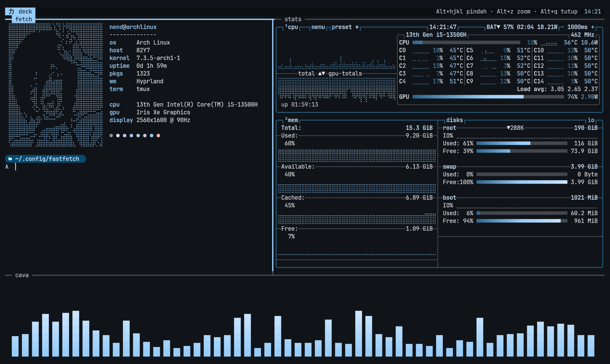

<div align="center">

# 力 nend's Ryoku dotfiles

**Arch Linux · Hyprland · Quickshell · one blue palette, everywhere**



</div>

My desktop on [Ryoku Linux](https://github.com/ryoku-dev/ryoku). Everything
takes its colours from the wallpaper through matugen, so the bar, terminal,
prompt, btop and cava all stay in the same blue family. If the wallpaper
changes, they follow.

## Highlights

### Command Deck (`Super + Shift + F`)

A floating terminal dashboard built from three panes in one tmux session:

| Pane | What it runs |
|---|---|
| **fetch** | fastfetch with a braille portrait as the logo |
| **stats** | btop (CPU + memory/disks only) with a theme generated from the live palette |
| **cava** | full-width audio visualiser along the bottom |

It runs on its own tmux server, so closing the window (`Alt + Q`) keeps btop
and cava alive and `Super + Shift + F` reattaches instantly.

| Key | Action |
|---|---|
| `Alt + H/J/K/L` or arrows | move between panes |
| `Alt + Shift + H/J/K/L` | resize |
| `Alt + Z` | zoom one pane |
| `Alt + R` | re-run fastfetch |
| `Alt + Q` | hide the deck (keeps running) |

### Prompt

Starship with Ryoku's pill layout: the path sits in a dark-blue pill so it
never blends into what you type.

### Panels and keybinds

| Key | Action |
|---|---|
| `Super + Shift + F` | Command Deck |
| `Super + C` | calendar + todo panel (Quickshell, `qs-calendar`) |
| `Super + X` | Now Playing + equaliser panel |
| `Super + D` | maximise (keeps bar and gaps) |
| `Super + Z` | ZapFast (WhatsApp) |

### The look


The whole Ryoku look (bar, theme, launcher, window decoration, widgets,
cursor, lock screen, wallpaper) ships as a Ryoku **rice** in `rice/nend`, so it
installs with Ryoku's own tools instead of copied config files.

## Stack

| | |
|---|---|
| Distro | Arch Linux + [Ryoku](https://github.com/ryoku-dev/ryoku) |
| Compositor | Hyprland (Lua config) |
| Shell UI | Quickshell (Ryoku QS Bar) |
| Terminal | kitty + tmux |
| Shell / prompt | fish + starship |
| Fetch / monitor / visualiser | fastfetch · btop · cava |
| Colours | matugen, generated from the wallpaper |
| Font | JetBrainsMono Nerd Font |

## Install

You need Ryoku installed first; this repo only holds what I changed on top of
it.

```bash
git clone https://github.com/danennh11/dotfiles ~/dotfiles
cd ~/dotfiles
./dot install --dry-run   # see what it would do
./dot install
```

`./dot install`:

1. installs `tmux chafa btop cava fastfetch starship`
2. symlinks the files in `links.txt` from `home/` into `$HOME`, backing up
   anything already there to `~/.dotfiles-backup/<time>/`
3. copies the Ryoku overlay files and runs `ryoku materialize`
4. sets the starship pill layout with wallpaper colours
5. imports the `nend` rice and asks before applying it
6. reloads Hyprland

`user.lua` also opens Brave, ZapFast and Vesktop on login. Remove those lines
if you don't use them.

## Keeping it in sync

Most files are symlinks into this repo, so editing them anywhere edits the
repo. Commit and push, then pull on the other machine.

```bash
./dot status              # linked / missing / in the way
./dot adopt ~/.config/x   # track another file or folder
./dot sync                # save edits made to the Ryoku overlay files
./dot rice                # re-capture the Ryoku look (personal data is scrubbed)
```

Files in `~/.config/ryoku/user_edits/` are copies, not symlinks, because
`ryoku materialize` skips symlinks there. Run `./dot sync` after editing one.

## Layout

```
dot                 install / status / adopt / sync / rice
links.txt           what goes where ("copy" = copied, the rest symlinked)
packages.txt        packages the deck and prompt need
home/               mirror of $HOME
  .config/hypr/user.lua            keybinds, window rules, startup apps
  .config/ryoku/user_edits/        forks of Ryoku files (overlay)
  .config/tmux/deck.conf           Command Deck tmux
  .config/fastfetch/deck*          deck fastfetch + logos
  .config/btop/deck.conf           deck btop
  .config/qs-calendar/             calendar / media panels
  .local/bin/                      ryoku-deck, theme generator, calendar-panel
rice/nend/          the Ryoku rice
scripts/            scrub-rice.py (strips IP/location from the rice)
assets/             screenshots
```

Not tracked on purpose: files Ryoku generates itself (`hypr/settings.lua`,
`starship.toml`, matugen outputs), monitor layout (differs per machine; set it
in Ryoku Hub › Displays).

## Credits

- [Ryoku](https://github.com/ryoku-dev/ryoku): the desktop this sits on
- [fastfetch](https://github.com/fastfetch-cli/fastfetch),
  [btop](https://github.com/aristocratos/btop),
  [cava](https://github.com/karlstav/cava),
  [tmux](https://github.com/tmux/tmux),
  [starship](https://starship.rs)
- The wallpaper and the portrait used for the deck logo belong to their
  original artists; they are not mine.
